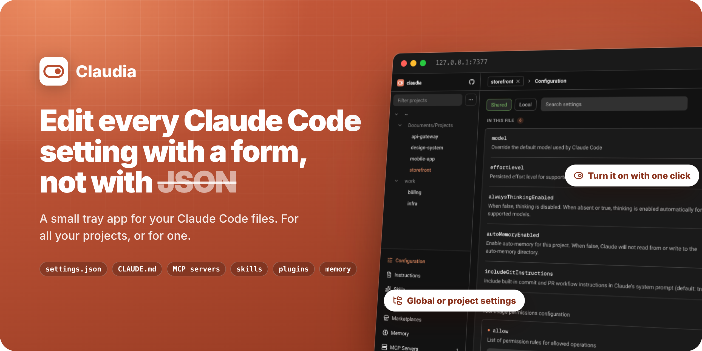

# Claudia



A tray app that manages your Claude Code `settings.json`, `CLAUDE.md`, memory, MCP servers, skills, plugins and marketplaces, globally and for each project folder. The interface runs in your browser at http://127.0.0.1:7377.

## Install

```bash
curl -fsSL https://raw.githubusercontent.com/claude-settings-xyz/claudia/main/install.sh | sh   # macOS, Linux
```

```powershell
irm https://raw.githubusercontent.com/claude-settings-xyz/claudia/main/install.ps1 | iex   # Windows
```

See the [installation docs](docs/content/docs/installation.mdx) for options and uninstalling.

## Layout

| Path              | What it is                                                        |
| ----------------- | ----------------------------------------------------------------- |
| `main.go`         | Entry point: flags, single instance check, HTTP server, tray      |
| `tray.go`         | Tray menu with Open, GitHub and Quit                              |
| `icon.go`         | Tray icon, drawn at startup                                       |
| `internal/claude` | Reads and writes Claude Code files, lists projects, skills and plugins |
| `internal/schema` | Reads the settings schema from the installed Claude Code          |
| `internal/server` | JSON API under `/api` and checks on every request                 |
| `web`             | React, Vite and shadcn interface. `web/embed.go` embeds the build |
| `docs`            | Landing page and docs, made with Fumadocs                         |
| `packaging`       | Files for platform packages, such as the macOS `Info.plist`       |
| `install.sh`      | Installer for macOS and Linux                                     |
| `install.ps1`     | Installer for Windows                                             |

## Commands

```bash
make build    # web, then bin/claudia
make dev      # Go API on :7377 and Vite on :5173
make test     # go vet and go test
make app      # bin/Claudia.app for macOS (menu bar only)
make release  # release assets and checksums in bin/release
make docs     # docs dev server. cd docs && npm run build writes the static site to docs/out
make settings-schema  # refresh the settings list of the docs homepage from your Claude Code
```

You need Go 1.26 or later and Node.js 24 or later.

## Workflows

| Workflow | What it does |
| -------- | ------------ |
| [CI](.github/workflows/ci.yml) | Builds the web interface, runs `go vet`, `go test` and the web lint, and builds for Windows and Linux. |
| [Release](.github/workflows/release.yml) | Run it from the Actions tab. It builds the assets on macOS, because the macOS tray needs cgo, and makes a draft release named after the version in `VERSION`, with `SHA256SUMS`. Publish the draft on the Releases page, and GitHub creates the tag. |
| [Docs](.github/workflows/docs.yml) | Builds the docs for pull requests, and publishes them to GitHub Pages from `main`. Set Pages > Source to GitHub Actions in the repository settings. |

## Security

The server only listens on 127.0.0.1. It refuses requests with a different `Host` header, which blocks DNS rebinding. API requests must send an `X-Claudia` header. Browsers do not let other websites send that header, so they cannot change your files.

## License

[MIT](LICENSE)
